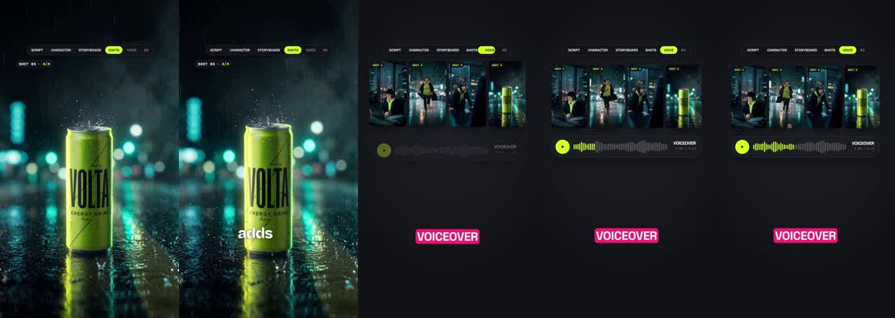

# v07_s13 · window_only · 27.1–28.1s (calidad 4)

- **Guion:** adds the voiceover,
- **Qué se ve:** Plano de la lata en calle mojada (27.0–27.4) y luego lienzo negro con tira de planos + reproductor con forma de onda lima 'VOICEOVER' (pestaña VOICE). (observado)
- **Diseño:** 'VOICEOVER' caja magenta a y≈73 %.
- **Efectos:** —
- **Animación:** Corte a 27.43; la forma de onda se dibuja de izquierda a derecha (~0.5 s).
- **Por qué aquí:** Audio visualizado como onda.
