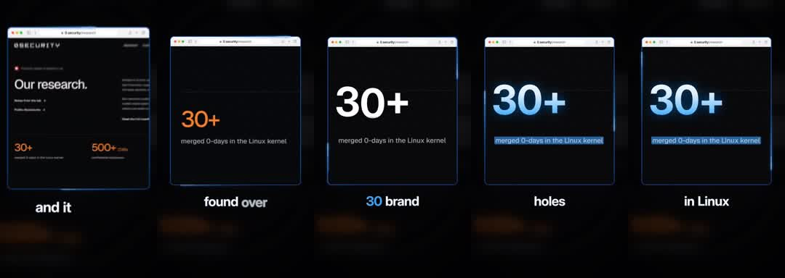

# v08_s03 · window_only · 4.9–7.9s (calidad 5)

- **Guion:** and it already found over 30 brand new security holes in Linux.
- **Qué se ve:** Lienzo negro con resplandor naranja desenfocado: web de 0security 'Our research.' que hace scroll con motion blur hacia el dato '30+ merged 0-days in the Linux kernel'; el número rueda (89→28→30+), luego crece, brilla en azul y se resalta la línea. (observado 4.85–7.5)
- **Diseño:** Ventana x 8.7–91.3 % × y 13.3–66.4 %; '30+' sans bold blanca enorme (~8 % alto) que pasa a azul con glow; caption blanco y≈73 %, '30' azul.
- **Efectos:** Fondo #000 con mancha cálida #301008 desenfocada (bokeh); motion blur vertical en el scroll; glow azul del número.
- **Animación:** Corte seco 4.85; scroll con blur 5.4–5.5; contador tipo tragaperras 5.75–6.0; zoom al número 6.25; glow 6.5; resaltado 6.75.
- **Por qué aquí:** Dato de autoridad (30 vulnerabilidades en Linux) aislado y ampliado.
