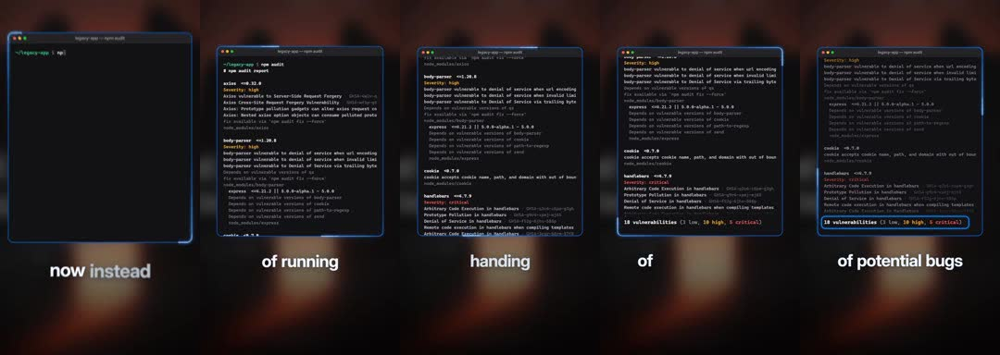

# v08_s06 · window_only · 11.9–14.7s (calidad 4)

- **Guion:** Now instead of running a scan and handing you a list of potential bugs,
- **Qué se ve:** Negro con bokeh naranja: terminal 'legacy-app — npm audit' donde se teclea y salen decenas de líneas de vulnerabilidades; al final '10 vulnerabilities (1 low, 10 high, 9 critical)' contorneado en azul. (observado 11.9–14.5)
- **Diseño:** Terminal y 13.3–66.4 %; texto mono rojo/blanco; caption blanco y≈73 %.
- **Efectos:** Bokeh cálido de fondo.
- **Animación:** Typing de comando (11.9–12.4), scroll rápido de salida (12.5–13.5), contorno en la línea resumen a 13.5.
- **Por qué aquí:** El 'método viejo' (lista de bugs) mostrado como ruido para contrastar.
