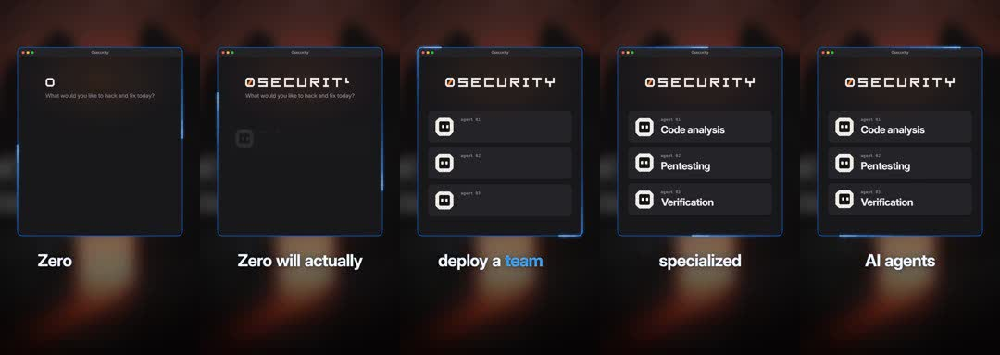

# v08_s07 · window_only · 14.7–17.7s (calidad 4)

- **Guion:** Xero will actually deploy a team of specialized AI agents
- **Qué se ve:** La terminal se vacía y se escribe letra a letra el logo '0SECURITY' (14.75–15.25); aparecen 3 huecos de agente que se rellenan: Code analysis, Pentesting, Verification. (observado)
- **Diseño:** 'team' en azul; 'Zero' en caption.
- **Efectos:** —
- **Animación:** Typewriter del logo; huecos pop y etiquetas que pasan de gris a blanco una a una (~0.25 s).
- **Por qué aquí:** 'Equipo de agentes' = 3 tarjetas nombradas.
