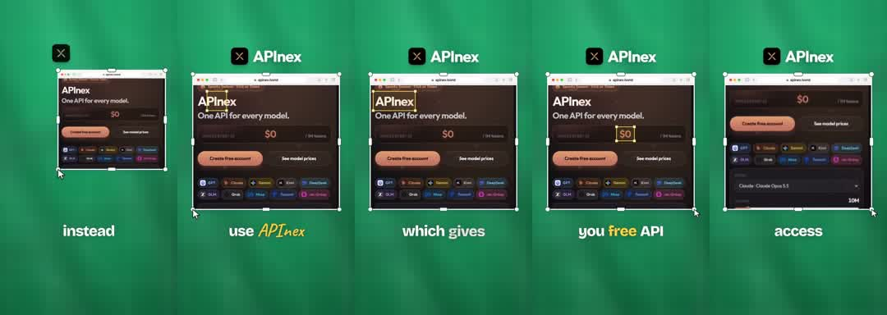

# v09_s02 · window_only · 2.7–5.6s (calidad 4)

- **Guion:** Instead, use Apanex, which gives you free API access
- **Qué se ve:** Sin título ni cara: cabecera con logo X + 'APInex' que se teclea y ventana de navegador con la landing 'APInex · One API for every model', precio $0. Marco amarillo con asas cuadradas alrededor de 'APInex' (3.5) y del '$0' (4.5). (observado 2.7–5.5)
- **Diseño:** Cabecera y≈18 %; ventana x 8.3–91 % × y 23.4–66.4 %; caption blanco y≈73 %: 'APInex' en script itálica amarilla, 'free' amarillo.
- **Efectos:** Lienzo verde.
- **Animación:** Ventana entra con escala desde ~60 % a 100 % (~0.3 s, 2.7–3.0); logo typewriter (2.95–3.1); marcos de selección amarillos aparecen de golpe.
- **Por qué aquí:** Nombre de la solución → su web, con el nombre y el precio enmarcados.
