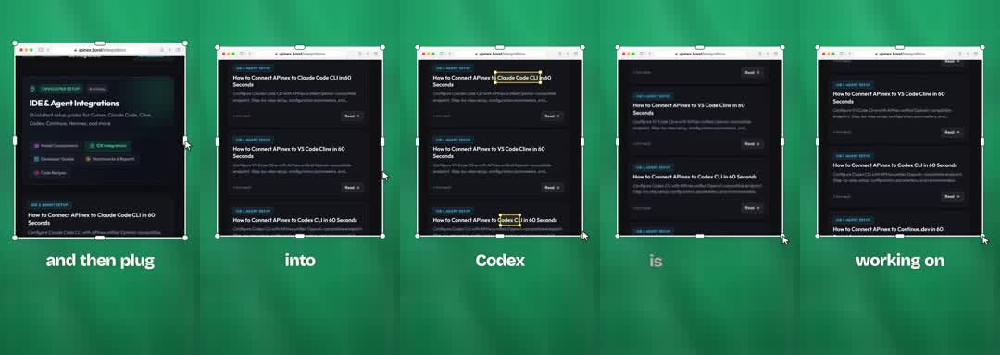

# v09_s09 · window_only · 18.8–22.3s (calidad 4)

- **Guion:** and then plug it straight into Cloud Code, Codex, or whatever it is that you're working on.
- **Qué se ve:** Página 'IDE & Agent Integrations' con guías 'How to Connect APInex to Claude Code CLI / VS Code Cline / Codex CLI…'; scroll; marcos amarillos sobre 'Claude Code CLI' (19.75) y 'Codex' (20.5). (observado 18.7–22.0)
- **Diseño:** Ventana y 13.3–66.4 %; caption blanco y≈73 %.
- **Efectos:** —
- **Animación:** Corte seco 18.7; scroll suave con marcos de selección que siguen las palabras.
- **Por qué aquí:** Compatibilidad mostrada en la documentación real.
