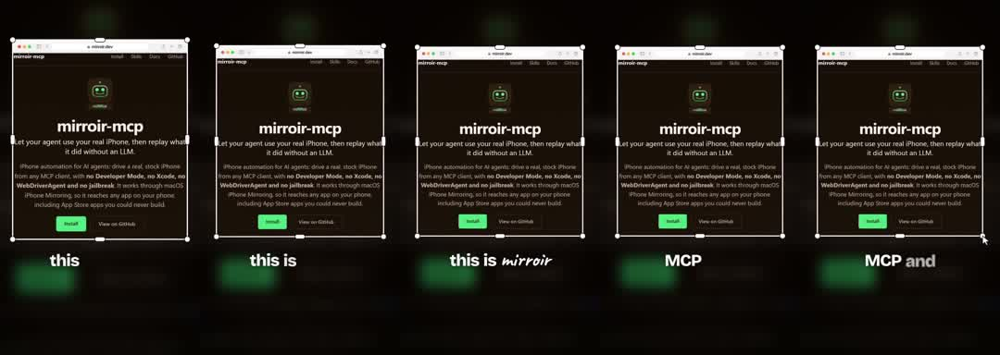

# v10_s03 · window_only · 4.9–6.2s (calidad 4)

- **Guion:** This is Mirar MCP,
- **Qué se ve:** Lienzo negro con mancha verde desenfocada abajo: web 'mirroir-mcp' (logo robot verde, 'Let your agent use your real iPhone…', botón verde Install). (observado 4.85–6.0)
- **Diseño:** Ventana x 8.8–91.4 % × y 13–66.3 %, borde fino blanco con asas. Caption blanco y≈73 %; 'mirroir' script itálica.
- **Efectos:** Negro #080000 con bokeh verde (eco del botón Install).
- **Animación:** Corte seco 4.85.
- **Por qué aquí:** Nombre → web del producto.
