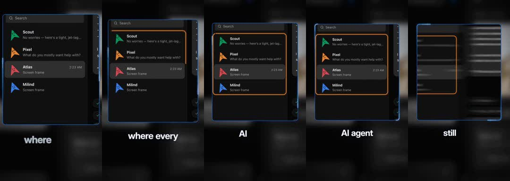

# v11_s02 · window_only · 3.0–4.3s (calidad 4)

- **Guion:** where every AI agent still
- **Qué se ve:** [obs 3.0–4.0] Corte a lienzo negro: solo la ventana (lista de agentes Scout, Pixel, Atlas, Milind con iconos de colores) sobre un fondo que es la misma UI ampliada y desenfocada; un recuadro naranja redondeado agrupa los agentes; subtítulo blanco debajo.
- **Diseño:** [obs/medido 4.0] Ventana x 8.6–91.5 %, y 13.2–66.5 %, radio ~20 px, borde azul fino #2969C2 con glow; recuadro interior naranja #F08A24 aprox. 3 px. Subtítulo sans bold blanca ~4.5 % alto en y≈73 %.
- **Efectos:** [obs] Fondo = copia desenfocada (blur fuerte) y oscurecida de la UI; viñeta negra #050505 en bordes.
- **Animación:** [obs 3.07–3.33] Entra con desenfoque de movimiento/escala (la ventana llega borrosa y se asienta en ~0.2 s); el recuadro naranja ya está.
- **Por qué aquí:** [inf] Cambio de diseño al describir el concepto (cada agente) → se muestra solo la herramienta, sin cara.
