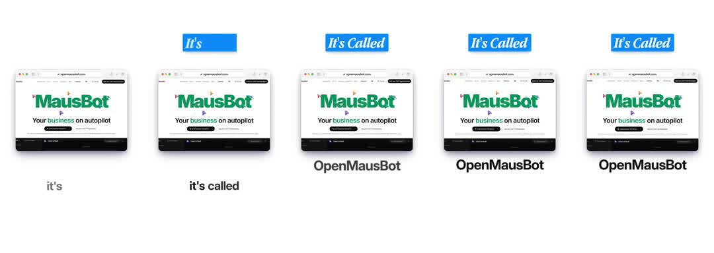

# v11_s05 · window_only · 8.4–9.7s (calidad 4)

- **Guion:** It's called Open Mousebot, and
- **Qué se ve:** [obs 8.25–9.5] Lienzo blanco puro: captura web de 'MausBot — Your business on autopilot'; arriba una caja azul con 'It's Called' en serif itálica; debajo 'OpenMausBot' grande.
- **Diseño:** [medido 9.0] Caja azul #0082FD y 13.3–20.3 %, ~30 % ancho, centrada, texto serif itálica blanca; ventana ~65 % ancho centrada y≈23–42 %; 'OpenMausBot' sans bold gris oscuro #333 ~5 % alto en y≈48 %.
- **Efectos:** [obs] Blanco #FFFFFF plano sin grano; sombra suave bajo la ventana.
- **Animación:** [obs 8.5–8.75] la caja azul aparece como un cuadrado pequeño y se expande horizontalmente (≈0.25 s) antes del texto; 'it's called' en gris claro → se reemplaza por el nombre.
- **Por qué aquí:** [inf] Name card del producto: lienzo blanco = momento 'presentación' distinto del resto.
