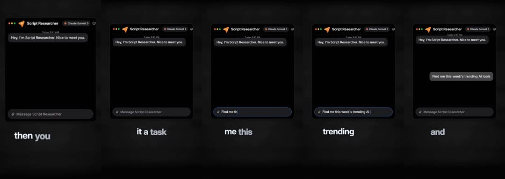

# v11_s09 · window_only · 17.4–21.0s (calidad 4)

- **Guion:** Then you just give it a task, like find me this week's trending AI tools, and it'll
- **Qué se ve:** [obs 17.5–21.0] Lienzo negro: chat con 'Script Researcher' ('Hey, I'm Script Researcher. Nice to meet you.'); en la barra inferior se escribe 'Find me this week's trending AI tools' al ritmo de la voz y en 20.75 se envía como burbuja.
- **Diseño:** Ventana negra x 8–92 %, y≈10–58 %; subtítulo blanco y≈73 %.
- **Efectos:** [obs] fondo negro con viñeta; sin fondo desenfocado visible (UI casi negra).
- **Animación:** [obs] typing en el input sincronizado a la voz (≈1 palabra cada 0.25 s); burbuja sube al chat en 20.75 (≈0.2 s).
- **Por qué aquí:** [inf] Demostración en tiempo real: el espectador ve la orden que se da.
