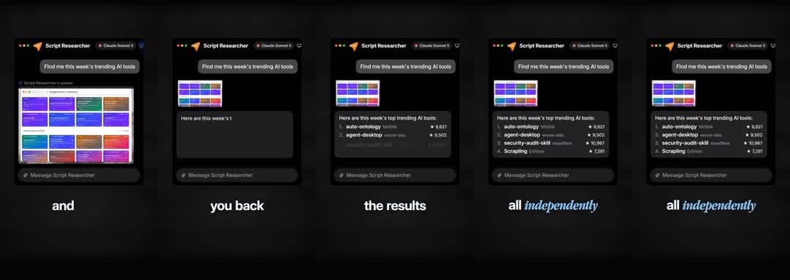

# v11_s11 · window_only · 24.0–26.3s (calidad 4)

- **Guion:** and send you back the results all independently.
- **Qué se ve:** [obs 24.25–26.0] La pantalla se reduce a miniatura y aparece la respuesta 'Here are this week's top trending AI tools:' con lista numerada (auto-ontology, agent-desktop, security-audit-skill, Scraping) y estrellas.
- **Diseño:** 'independently' serif itálica bold azul (#3D7BF0 aprox.) junto a 'all' sans bold blanca.
- **Efectos:** —
- **Animación:** [obs] la miniatura se encoge (≈0.25 s) y la lista se escribe línea a línea (24.5–25.25).
- **Por qué aquí:** [inf] Resultado final del ejemplo; la serif itálica marca el beneficio clave ('independently').
