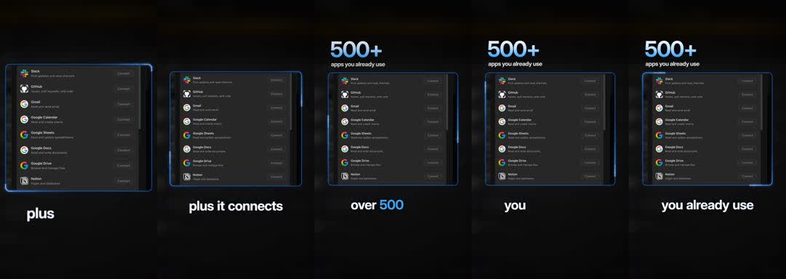

# v11_s13 · window_only · 30.0–32.4s (calidad 5)

- **Guion:** Plus it connects over 500 apps you already use,
- **Qué se ve:** [obs 30.0–32.25] Lienzo negro: lista de integraciones (Slack, GitHub, Gmail, Google Calendar, Sheets, Docs, Drive, Notion) con botones 'Connect'; en 31.0 aparece arriba-izquierda '500+' grande con 'apps you already use'.
- **Diseño:** [medido 31.5] '500+' sans bold blanca ~8 % alto en y≈5–10 %, alineada a la izquierda (x≈11 %); ventana y 26–66 % con borde azul #3999F1; '500' del subtítulo en azul #2F9AF7.
- **Efectos:** [obs] fondo desenfocado de la misma UI; glow azul en el borde.
- **Animación:** [obs 30.0–30.5] ventana entra con slide hacia arriba (y 13 %→26 %) dejando sitio al título; '500+' pop en 31.0.
- **Por qué aquí:** [inf] Dato numérico → cifra grande como titular.
