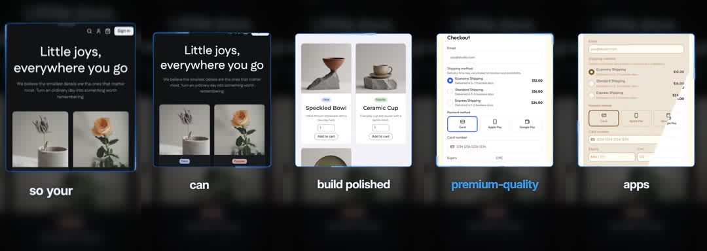

# v12_s02 · window_only · 3.8–6.7s (calidad 4)

- **Guion:** so your cloud can now build polished, premium quality apps the
- **Qué se ve:** [obs 3.75–6.5] Lienzo oscuro con fondo desenfocado: ventana con la tienda oscura 'Little joys'; en 4.85 se sustituye por fichas de producto (Speckled Bowl, Ceramic Cup) y en 5.55 por un Checkout; en 6.0 el checkout pasa a tema crema.
- **Diseño:** Ventana x 8.6–91.4 %, y 13.3–66 %; subtítulo blanco y≈72–76 %; 'Claude' en serif itálica azul (transcrito 'cloud'); 'premium-quality' en azul.
- **Efectos:** [obs] Fondo = la UI ampliada y desenfocada, oscurecida; viñeta.
- **Animación:** [obs 4.85, 5.55, 6.0] cambios de página con **barrido diagonal** (borde inclinado ~60° que cruza la ventana de derecha a izquierda en ≈0.2 s).
- **Por qué aquí:** [inf] 'polished, premium quality' se demuestra con varias pantallas bonitas seguidas.
