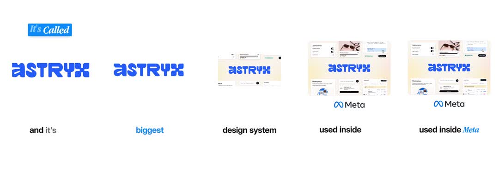

# v12_s05 · window_only · 9.7–12.0s (calidad 4)

- **Guion:** and it's the biggest design system used inside Meta,
- **Qué se ve:** [obs 9.75–11.75] El logotipo se reduce y detrás aparece una captura de la web de Astryx; debajo el logo '∞ Meta'.
- **Diseño:** Logotipo azul centrado y≈20 %; captura ~65 % ancho y≈17–25 %; '∞ Meta' gris y≈24 %; subtítulo gris oscuro y≈52 %, 'biggest' azul, 'Meta' serif itálica azul.
- **Efectos:** [obs] blanco plano.
- **Animación:** [obs 10.25–11.0] el logotipo encoge (escala ≈1.0→0.75) y la captura aparece con fade detrás; logo Meta pop en 11.25.
- **Por qué aquí:** [inf] Asocia el producto con Meta (prueba de autoridad) justo al decir 'inside Meta'.
