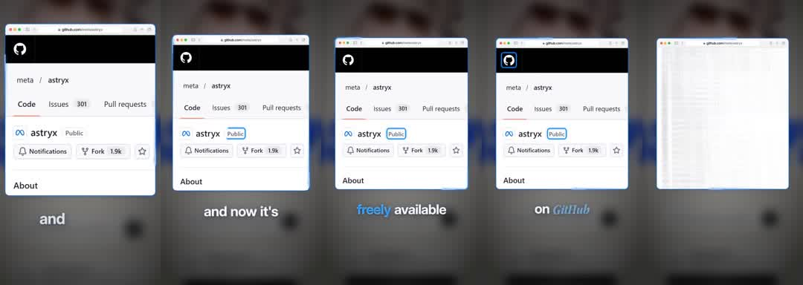

# v12_s08 · window_only · 15.5–17.1s (calidad 3)

- **Guion:** And now it's freely available on GitHub with
- **Qué se ve:** [obs 15.5–16.75] Lienzo oscuro con banda azul desenfocada detrás: repo de GitHub 'meta / astryx'; el badge 'Public' se recuadra en azul.
- **Diseño:** Ventana y 13.3–40 %; subtítulo blanco y≈72–76 %; 'freely' azul, 'GitHub' serif itálica azul.
- **Efectos:** [medido 18.5] fondo gris cálido #373531–#444240 con franja azul #203263 desenfocada (UI ampliada).
- **Animación:** [obs 15.43] corte seco; recuadro azul en 'Public' a 15.75.
- **Por qué aquí:** [inf] 'freely available' → badge Public = prueba.
