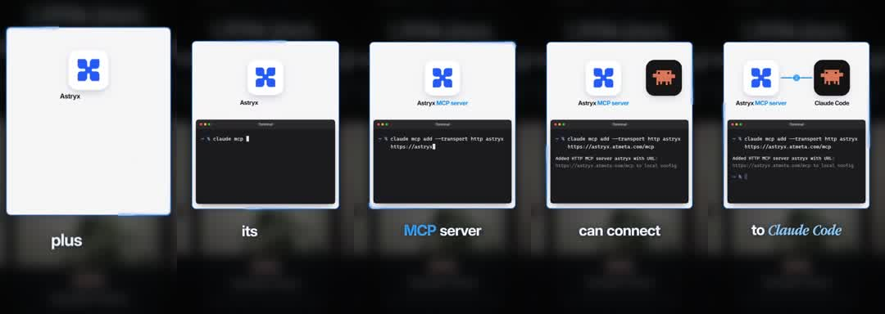

# v12_s12 · window_only · 24.4–27.3s (calidad 4)

- **Guion:** Plus it has its own MCP server that you can connect to cloud code,
- **Qué se ve:** [obs 24.25–27.25] Lienzo oscuro: panel blanco con icono Astryx ('Astryx MCP server') y terminal donde se teclea 'claude mcp add --transport http astryx https://astryx.atmeta.com/mcp'; aparece icono de Claude Code y una línea de conexión.
- **Diseño:** Panel blanco y 13.3–66.4 %; terminal oscura dentro; 'MCP' azul, 'Claude Code' serif itálica azul.
- **Efectos:** [obs 24.25] panel vacío blanco primero.
- **Animación:** [obs] typing del comando 24.75–26.0; icono Claude Code pop 26.5; conector se dibuja 26.75; terminal confirma 'Added HTTP MCP server'.
- **Por qué aquí:** [inf] Muestra la instalación real: el espectador ve que es un comando.
