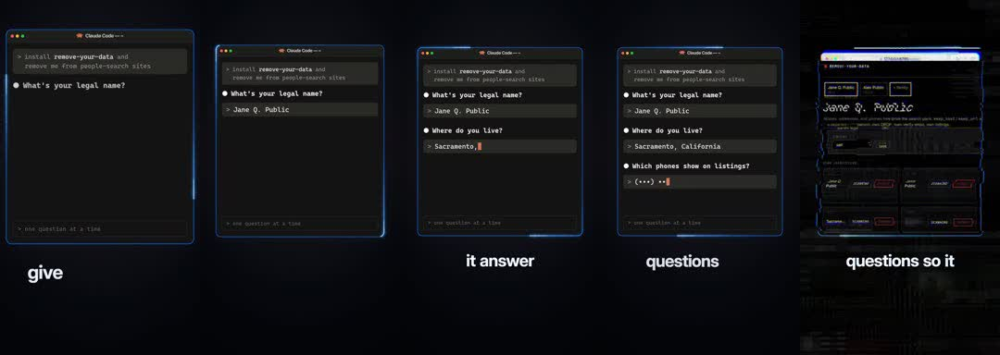

# v13_s07 · window_only · 15.4–17.7s (calidad 4)

- **Guion:** get it your name, and have it answer a couple quick questions so it
- **Qué se ve:** [obs 15.25–17.25] Negro: ventana de Claude Code (terminal) con 'install remove-your-data…' y preguntas que se responden: 'What's your legal name?' → 'Jane Q. Public'; 'Where do you live?' → 'Sacramento, California'; 'Which phones show on listings?'.
- **Diseño:** Terminal oscura mono; ventana y≈12–66 %; subtítulo blanco y≈73 %.
- **Efectos:** [obs] glow azul en el borde.
- **Animación:** [obs] typing de respuestas sincronizado (15.75 nombre, 16.5 ciudad, 17.0 teléfonos).
- **Por qué aquí:** [inf] Muestra la sencillez del setup.
