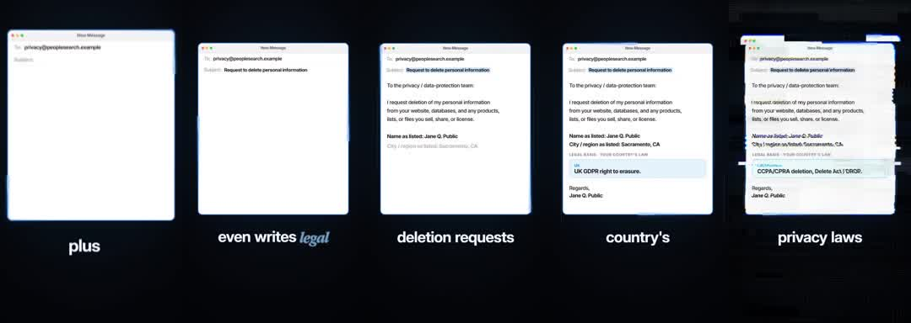

# v13_s11 · window_only · 26.1–29.8s (calidad 4)

- **Guion:** Plus, it even writes legal deletion requests under your country's privacy laws and
- **Qué se ve:** [obs 26.0–29.5] Negro: ventana 'New Message' a privacy@peoplesearch.example que se escribe sola; el bloque 'Legal basis — your country's law' cambia GDPR Art. 17 → UK GDPR → California CCPA/CPRA.
- **Diseño:** 'legal' serif itálica azul; caja del fundamento legal azul claro.
- **Efectos:** —
- **Animación:** [obs] email vacío 26.0 → asunto 27.0 → cuerpo 27.5–28.0; cambio de ley 28.25, 28.75, 29.0 al decir 'country's'.
- **Por qué aquí:** [inf] 'your country's' → se ve cómo se adapta por país.
