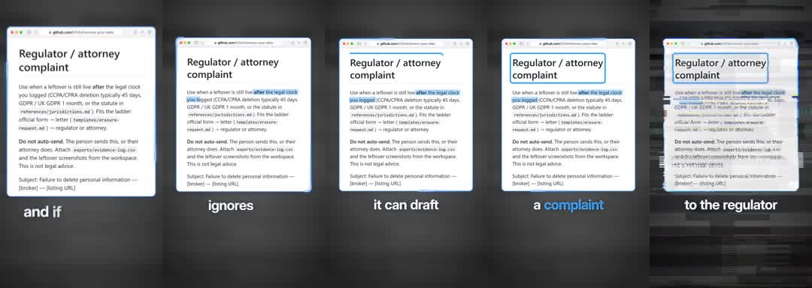

# v13_s14 · window_only · 35.3–38.0s (calidad 3)

- **Guion:** And if a company ignores you, it can draft a complaint to the regulator,
- **Qué se ve:** [obs 35.25–37.75] Lienzo gris: documento 'Regulator / attorney complaint'; se resalta 'after the legal clock you logged' y el título se recuadra en azul (36.75).
- **Diseño:** 'complaint' azul.
- **Efectos:** gris radial
- **Animación:** [obs 35.25] corte; resaltado 36.0; recuadro 36.75.
- **Por qué aquí:** [inf] Escalada legal mostrada como documento real.
