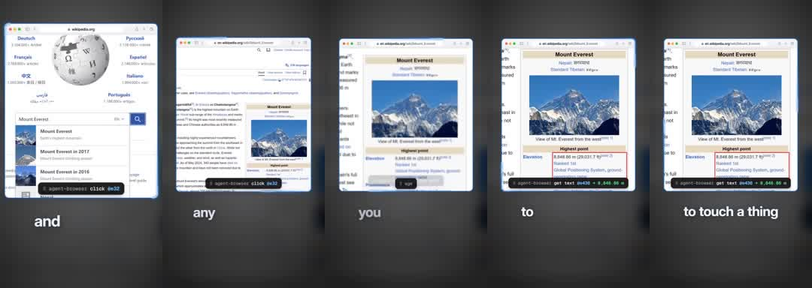

# v14_s02 · window_only · 3.8–7.0s (calidad 4)

- **Guion:** and complete any task without you ever having to touch a thing,
- **Qué se ve:** [obs 4.0–6.75] Lienzo gris oscuro: ventana con la página de Wikipedia 'Mount Everest' que hace scroll; abajo chip 'agent-browser click @e32' y luego 'get text @e36 → 8,848.86 m'; el dato 'Elevation' se recuadra en rojo.
- **Diseño:** Ventana x 8.6–91.4 %, y 13.3–66.4 %; recuadro rojo #E03A3A fino; subtítulo blanco y≈73 %.
- **Efectos:** [obs] fondo gris #272727 con UI desenfocada.
- **Animación:** [obs] cambio de página con slide (4.25); scroll 4.5–5.0; recuadro rojo 5.75.
- **Por qué aquí:** [inf] 'complete any task' → el agente navega y extrae un dato sin manos.
