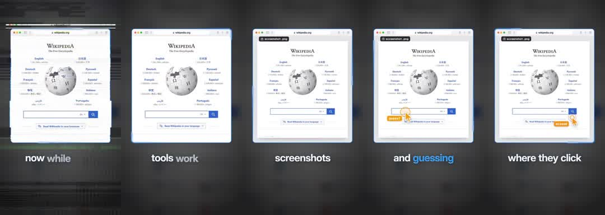

# v14_s08 · window_only · 17.1–20.6s (calidad 5)

- **Guion:** Now while most tools work by taking screenshots and guessing where they click,
- **Qué se ve:** [obs 17.0–20.5] Glitch → Wikipedia; aparece etiqueta 'screenshot.png' arriba-izquierda (18.75); un cursor con chip naranja 'guess?' se mueve dudando (19.25–20.25) y aparece etiqueta roja 'missed'.
- **Diseño:** Ventana y 13.3–66.4 %; chips: naranja #F5A623 aprox. 'guess?', rojo 'missed'; 'guessing' azul.
- **Efectos:** [obs 17.0] glitch de franjas; fondo gris desenfocado.
- **Animación:** [obs] cursor se desplaza en arco; chips pop.
- **Por qué aquí:** [inf] Muestra el problema de los competidores (adivinar) antes de la solución.
