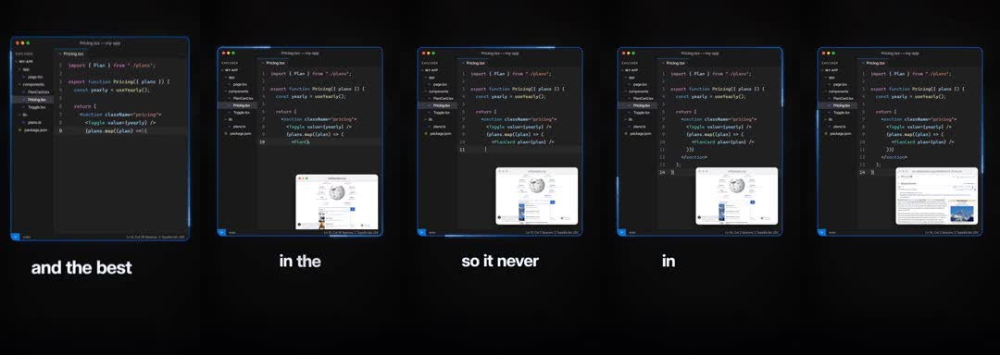

# v14_s13 · window_only · 31.6–35.4s (calidad 5)

- **Guion:** And the best part is, it runs in the background, so it never actually has to get in the way of your work.
- **Qué se ve:** [obs 31.5–35.25] Negro: editor de código oscuro (React 'Pricing') donde se sigue escribiendo; en la esquina inferior derecha aparece una mini ventana del navegador del agente trabajando.
- **Diseño:** Ventana y 13–66 %; miniatura ~30 % ancho de la ventana; 'background' azul.
- **Efectos:** [obs] glow azul en el borde; fondo negro.
- **Animación:** [obs] miniatura pop 32.25; su contenido cambia (34.75); código se escribe línea a línea.
- **Por qué aquí:** [inf] 'runs in the background' literal: tu trabajo arriba, el agente en una esquina.
