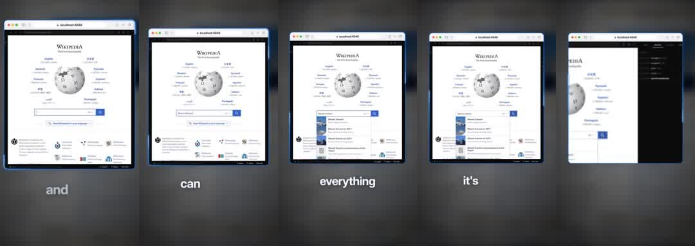

# v14_s15 · window_only · 37.9–39.3s (calidad 3)

- **Guion:** and you can watch everything it's doing on a
- **Qué se ve:** [obs 38.0–39.0] Gris oscuro: ventana 'localhost:4848' mostrando Wikipedia en vivo con la búsqueda del Everest.
- **Diseño:** Ventana y 13–66 %.
- **Efectos:** fondo desenfocado
- **Animación:** [obs 37.95] la ventana entra deslizándose desde arriba-izquierda (≈0.2 s).
- **Por qué aquí:** [inf] 'watch' → vista en vivo.
