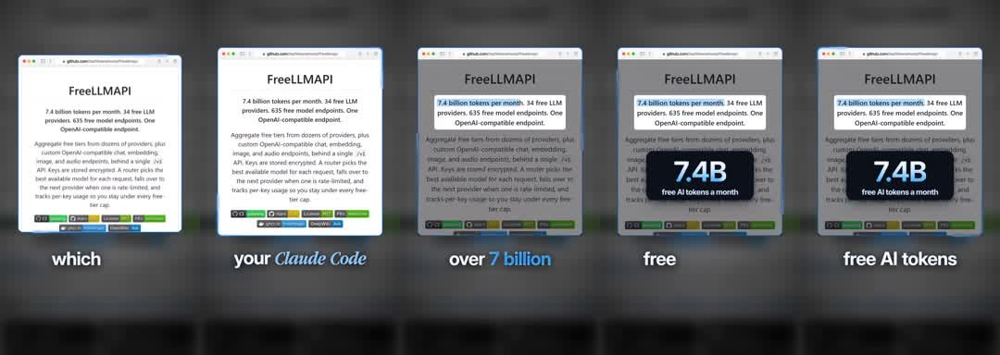

# v15_s07 · window_only · 13.5–16.4s (calidad 4)

- **Guion:** which gives your cloud code over 7 billion free AI tokens
- **Qué se ve:** [obs 13.5–16.25] Gris oscuro con fondo desenfocado: página FreeLLMAPI; se resalta '7.4 billion tokens per month' y aparece tarjeta glass '7.4B free AI tokens a month'.
- **Diseño:** Ventana y 13–66 %; '7 billion' azul; tarjeta oscura con '7.4B' sans bold blanca ~5 % alto.
- **Efectos:** [obs] glass.
- **Animación:** [obs] resaltado 14.75; tarjeta pop 15.0.
- **Por qué aquí:** [inf] Cifra → tarjeta.
