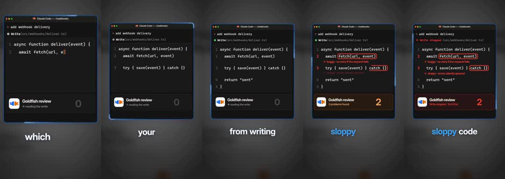

# v15_s14 · window_only · 33.2–35.9s (calidad 5)

- **Guion:** which stops your AI from writing buggy, sloppy code,
- **Qué se ve:** [obs 33.25–35.5] Gris oscuro: editor 'Claude Code — webhooks' donde se escribe código; abajo panel 'Goldfish review' con contador 0 → 1 (línea 'await fetch' recuadrada en rojo, 'buggy') → 2 ('catch {}' recuadrado, 'sloppy').
- **Diseño:** Recuadros rojos #E03A3A; contador naranja/rojo; 'buggy'/'sloppy' azul.
- **Efectos:** [obs] panel del contador cambia a fondo rojo oscuro al detectar error.
- **Animación:** [obs] typing 33.25–34.25; error 1 a 34.75; error 2 a 35.0.
- **Por qué aquí:** [inf] 'buggy, sloppy' → errores marcados al decirlos.
