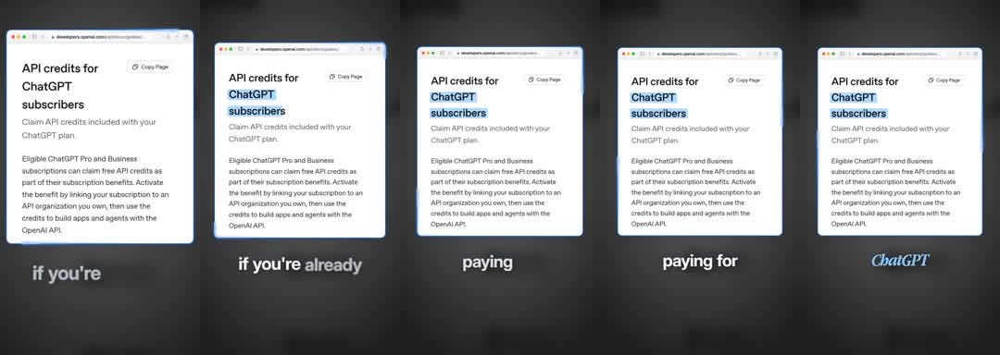

# v16_s04 · window_only · 5.6–7.1s (calidad 3)

- **Guion:** If you're already paying for ChatGBT,
- **Qué se ve:** Lienzo oscuro con viñeta; ventana de navegador (developers.openai.com) 'API credits for ChatGPT subscribers'. Resaltado azul en 'ChatGPT subscribers'. Caption 'if you're already' y luego 'ChatGPT' serif itálica.
- **Diseño:** Ventana x 10–90 % × y ≈27–43 % (aprox, tarjeta alta), borde azul #1D67BF fino; caption a y≈73 % sans bold blanca; 'ChatGPT' serif itálica azul claro.
- **Efectos:** [observed] Lienzo radial #3A3A3A centro → #141414 esquinas (viñeta fuerte); glow azul tenue alrededor de la ventana.
- **Animación:** [observed 5.53] corte seco; la ventana sube ~1 % y se asienta (≈0.2 s). [observed 5.8] resaltado de texto aparece.
- **Por qué aquí:** [inferred] Prueba documental oficial de la condición ('ya pagas ChatGPT').
