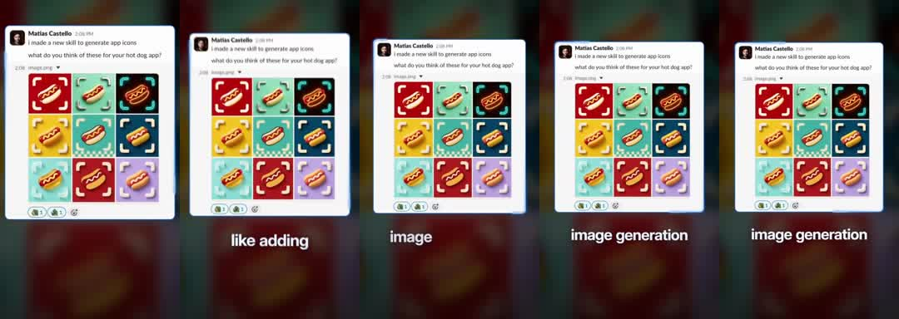

# v16_s10 · window_only · 15.6–16.6s (calidad 4)

- **Guion:** like adding image generation
- **Qué se ve:** Mensaje de Slack (Matías Castello: 'i made a new skill to generate app icons…') con rejilla 3×3 de iconos de perrito caliente; fondo = versión ampliada y desenfocada de la misma imagen (rojos/verdes).
- **Diseño:** Ventana tarjeta blanca x 10–90 % × y ≈30–56 %; sin chrome de navegador. Caption y≈73 %.
- **Efectos:** Fondo blur fuerte de la propia imagen + oscurecido.
- **Animación:** [observed 15.6] corte seco; leve escala de asentamiento de la tarjeta (≈0.2 s).
- **Por qué aquí:** [inferred] Ejemplo concreto y colorido de 'image generation'.
