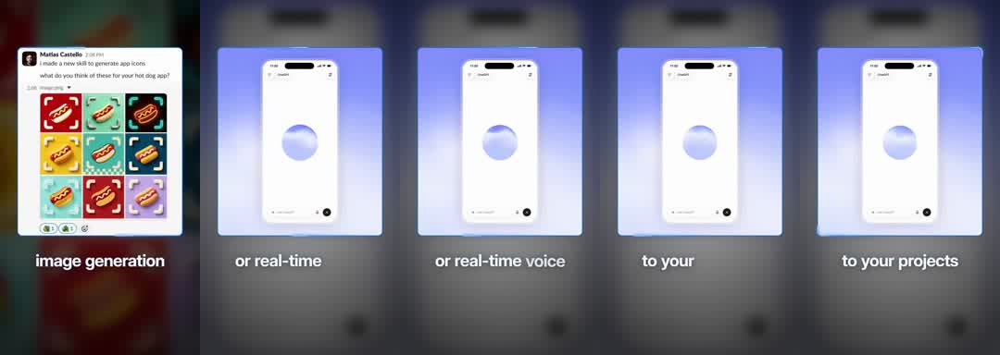

# v16_s11 · window_only · 16.6–18.0s (calidad 4)

- **Guion:** or real -time voice to your projects,
- **Qué se ve:** Tarjeta con degradado lila-azul y un móvil (app ChatGPT modo voz con orbe azul). Fondo desenfocado gris-lila.
- **Diseño:** Tarjeta x 10–90 % × y ≈31–55 %, degradado #8A9BF0→#E8ECFA; móvil centrado.
- **Efectos:** Blur de fondo; sombra suave.
- **Animación:** [observed 16.73] corte seco; orbe con pulso interno (vídeo).
- **Por qué aquí:** [inferred] Literal: 'real-time voice' = UI de voz.
