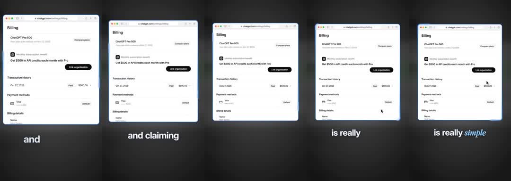

# v16_s15 · window_only · 23.2–24.2s (calidad 4)

- **Guion:** And claiming them is really simple.
- **Qué se ve:** Lienzo oscuro: ventana grande con chatgpt.com/settings/billing (ChatGPT Pro 500, Monthly subscription benefit, botón 'Link organization'). Cursor hacia el botón. Caption 'and claiming' / 'is really simple'.
- **Diseño:** [observed 23.5] Ventana x 8.7–91.5 % × y 11.6–67.1 % (≈56 % alto). Caption y≈74 %; 'simple' serif itálica azul.
- **Efectos:** Viñeta oscura; glow azul en borde.
- **Animación:** [observed 23.13–23.4] corte; la ventana entra un poco más ancha y se asienta escalando ~105→100 % (≈0.3 s).
- **Por qué aquí:** [inferred] Pasa al 'cómo': pantalla grande y protagonista.
