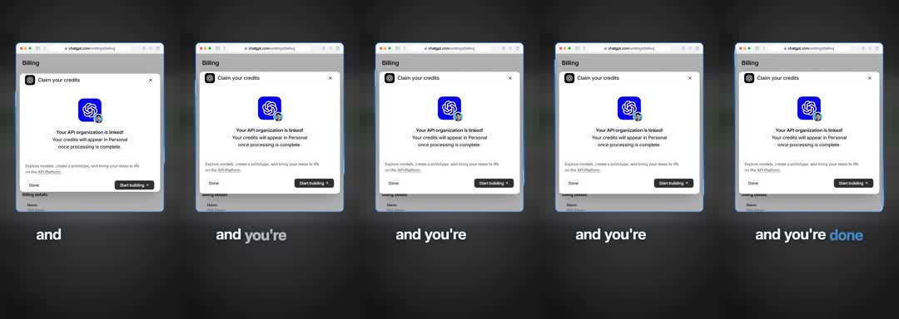

# v16_s17 · window_only · 27.3–27.9s (calidad 3)

- **Guion:** and you're done.
- **Qué se ve:** Modal de éxito con logo de OpenAI azul: 'Your API organization is linked!'. Caption 'and you're done' con 'done' azul.
- **Diseño:** Misma ventana.
- **Efectos:** —
- **Animación:** [observed 27.0] cambio de modal (corte interno).
- **Por qué aquí:** [inferred] Cierre del paso: resultado visible.
