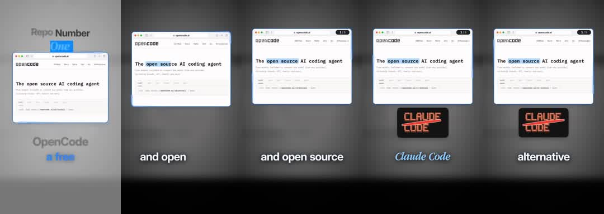

# v17_s05 · window_only · 6.0–7.8s (calidad 4)

- **Guion:** a free and open source cloud code alternative
- **Qué se ve:** Lienzo oscuro: ventana opencode.ai 'The open source AI coding agent' con 'open source' resaltado; debajo aparece la tarjeta-logo 'CLAUDE CODE' tachada en rojo.
- **Diseño:** [observed 8.0] Ventana x 10–90 %, y 13.3–48.6 %; tarjeta-logo ~20 % ancho a y≈52–58 %; caption y≈72 %; 'Claude Code' serif itálica azul.
- **Efectos:** Viñeta oscura.
- **Animación:** [observed 6.07–6.2] morph: la ventana del capítulo sube y crece mientras el blanco funde a oscuro (≈4 fr). [observed ~7.0] logo pop + tachado rojo.
- **Por qué aquí:** [inferred] 'alternative' = muestra lo que sustituye tachado.
