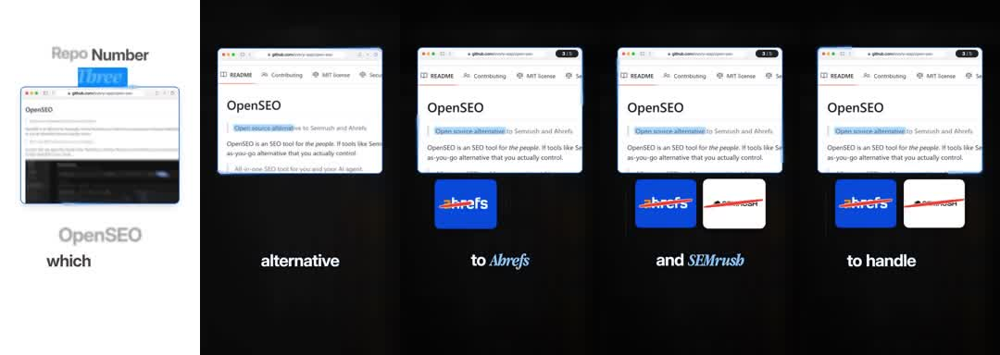

# v17_s14 · window_only · 21.5–24.5s (calidad 5)

- **Guion:** which is a free alternative to Ahrefs and SEMrush to handle your
- **Qué se ve:** Lienzo oscuro: README 'OpenSEO' (resaltado 'Open source alternative to Semrush and Ahrefs'); debajo tarjetas-logo Ahrefs (azul) y Semrush, ambas tachadas en rojo.
- **Diseño:** Ventana x 10–90 %, y ≈12–36 %; logos ~20 % ancho a y≈42–48 %. 'Ahrefs', 'SEMrush' serif itálica azul.
- **Efectos:** Viñeta.
- **Animación:** [observed 21.6–21.93] morph capítulo→ventana (sube/crece, blanco funde a gris). [observed 23.0, 23.5] logos pop + tachado.
- **Por qué aquí:** [inferred] Ancla 'alternativa' a las marcas caras.
