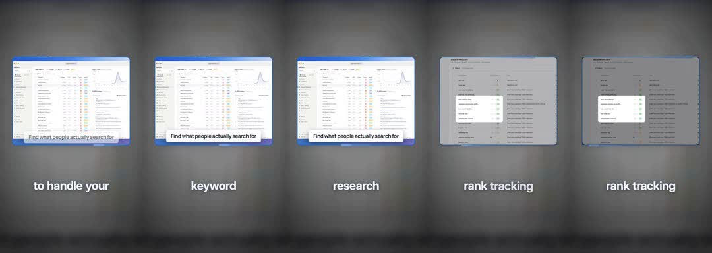

# v17_s15 · window_only · 24.5–26.2s (calidad 4)

- **Guion:** keyword research, rank tracking,
- **Qué se ve:** Capturas del dashboard OpenSEO con etiqueta-píldora blanca en la base de la ventana 'Find what people actually search for'; en 'rank tracking' zoom a una lista con check verdes.
- **Diseño:** Ventana x 9–91 %, y 22.4–57 %; píldora blanca radio total con texto negro ~1.5 % alto en el borde inferior.
- **Efectos:** Viñeta; lienzo algo más claro #5F5F5F.
- **Animación:** [observed 24.53] crossfade (≈2 fr); [observed 25.5] punch-in con recorte.
- **Por qué aquí:** [inferred] Cada función dicha = pantalla + etiqueta explicativa.
