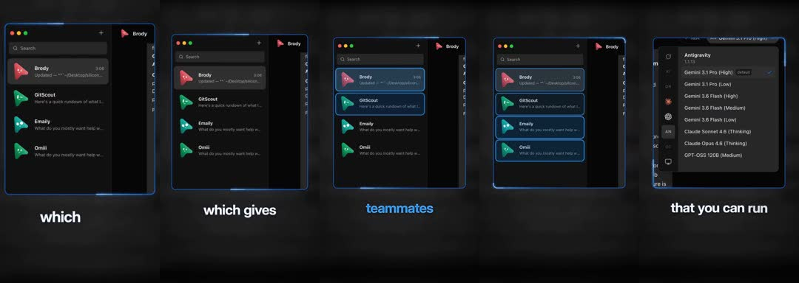

# v17_s19 · window_only · 32.6–34.3s (calidad 4)

- **Guion:** which gives you AI teammates that you can run
- **Qué se ve:** Lienzo casi negro: app oscura con lista de agentes (Brody, GitScout, Emaily, Omii) con iconos rojo/verde; en 'teammates' recuadros azules sobre cada agente.
- **Diseño:** Ventana x 10–90 %, y 12–67 %. 'teammates' sans azul.
- **Efectos:** Viñeta muy oscura #1F1F1F.
- **Animación:** [observed 32.53] corte; ventana asienta con escala ~1.03→1.0; [observed 33.5] outlines.
- **Por qué aquí:** [inferred] 'AI teammates' = los agentes visibles.
