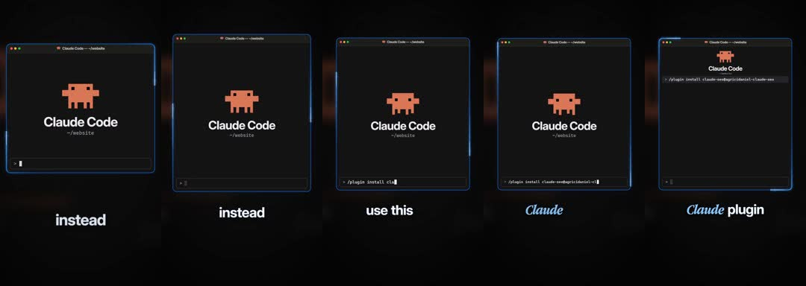

# v18_s02 · window_only · 2.6–4.3s (calidad 4)

- **Guion:** Instead, use this free Claude plugin
- **Qué se ve:** Lienzo casi negro: ventana de terminal 'Claude Code ~/website' con el logo pixelado naranja; se teclea '/plugin install claude-seo…'.
- **Diseño:** [observed 4.0] Ventana x 10–90 %, y 13.3–66.4 % (≈53 % alto), borde #0C52AE; caption y≈72 %; 'free' azul, 'Claude' serif itálica.
- **Efectos:** Viñeta negra.
- **Animación:** [observed 2.6–2.93] corte seco; la ventana entra con escala ~0.9→1.0 (≈5 fr, ease-out). Tecleo en vivo.
- **Por qué aquí:** [inferred] 'Instead' = cambio de tema → la herramienta.
