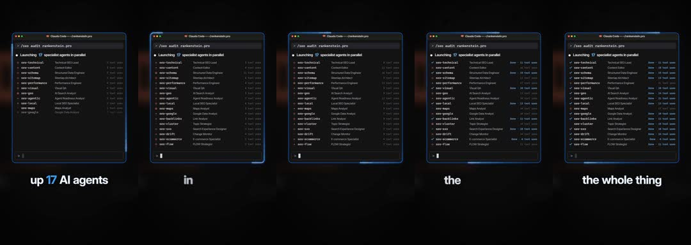

# v18_s12 · window_only · 23.6–25.6s (calidad 3)

- **Guion:** that work in parallel to analyze the whole thing
- **Qué se ve:** Terminal: 'Launching 17 specialist agents in parallel' con lista de agentes que se completan (done).
- **Diseño:** Texto monoespaciado verde/blanco.
- **Efectos:** —
- **Animación:** [observed 23.5–25.0] líneas aparecen y se marcan.
- **Por qué aquí:** [inferred] 'parallel' = lista larga simultánea.
