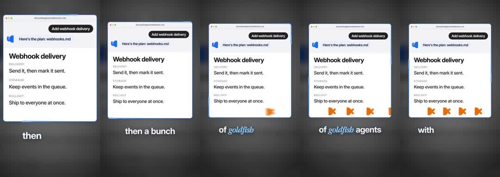

# v19_s11 · window_only · 17.4–19.3s (calidad 4)

- **Guion:** Then a bunch of goldfish agents with
- **Qué se ve:** Lienzo oscuro: tarjeta-documento 'Here's the plan: webhooks.md · Webhook delivery' (Delivery/Storage/Rollout); en la base aparecen 3 y luego 4 iconos de pez naranja.
- **Diseño:** Ventana x 10–90 %, y≈13–55 %; iconos ~5 % ancho en fila. 'goldfish' serif itálica azul.
- **Efectos:** Viñeta.
- **Animación:** [observed 17.4] corte + ventana sube y se asienta (≈6 fr); [observed 18.5, 19.0] peces pop.
- **Por qué aquí:** [inferred] 'a bunch of' = varios iconos.
