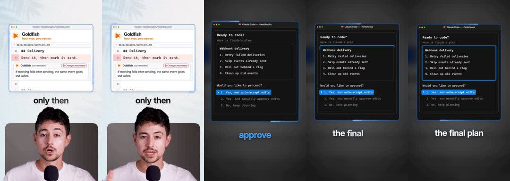

# v19_s16 · window_only · 31.7–33.4s (calidad 4)

- **Guion:** Only then, once you approve the final plan,
- **Qué se ve:** Lienzo oscuro: terminal 'Ready to code? Here is Claude's plan: Webhook delivery 1. Retry failed deliveries…' con opción '1. Yes, and auto-accept edits' resaltada en azul y el plan enmarcado en azul.
- **Diseño:** Ventana x 8.5–91.5 %, y 13–66 %; caja azul #047FF3 alrededor del plan. 'approve' azul.
- **Efectos:** Viñeta.
- **Animación:** [observed 32.13] corte; ventana escala ~1.03→1.0; [observed 32.47] opción resaltada; [observed 33.2] contorno del plan.
- **Por qué aquí:** [inferred] El momento de aprobación visible.
