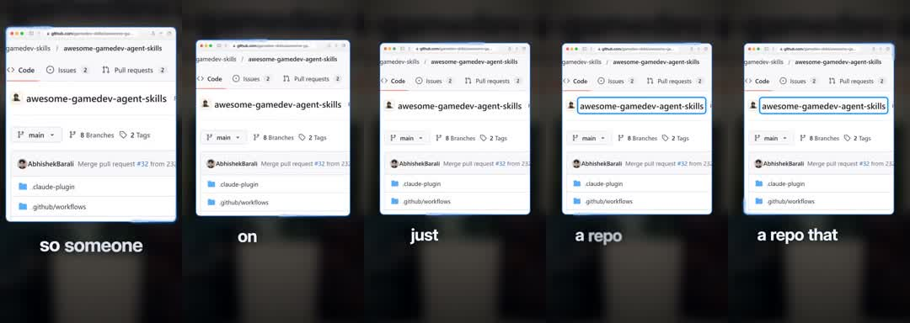

# v20_s03 · window_only · 4.3–6.1s (calidad 3)

- **Guion:** So someone on GitHub just created a repo that gives
- **Qué se ve:** Lienzo oscuro con gameplay desenfocado detrás; ventana GitHub 'gamedev-skills / awesome-gamedev-agent-skills'; en 'repo' el nombre queda enmarcado en azul.
- **Diseño:** [observed 5.0] Ventana x 10–90 %, y 13–66.5 %; contorno azul de selección alrededor del nombre (≈5.5). Caption y≈72 %.
- **Efectos:** Fondo blur del juego (cálido #272521) con viñeta.
- **Animación:** [observed 4.33–4.73] corte; la ventana entra más grande y se asienta (~1.05→1.0, ≈6 fr). [observed 5.5] contorno.
- **Por qué aquí:** [inferred] Fuente (GitHub) como prueba.
