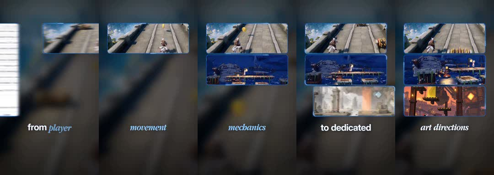

# v20_s11 · window_only · 20.5–23.8s (calidad 5)

- **Guion:** from player movement to platformer mechanics to dedicated art directions.
- **Qué se ve:** La lista sale por la izquierda con blur y entran desde la derecha clips de juego apilados: 1) personaje corriendo (player movement), 2) plataformas nocturnas (platformer mechanics), 3) castillo/arte (art directions); quedan 3 ventanas apiladas.
- **Diseño:** 3 ventanas de ~80 % ancho × 17 % alto apiladas en y≈13–66 %, cada una con borde azul. 'player', 'movement', 'platformer', 'mechanics', 'art directions' serif itálica azul.
- **Efectos:** Fondo blur azul/oscuro.
- **Animación:** [observed 20.47–20.7] whip horizontal: la lista sale a la izquierda y el 1.er clip entra desde la derecha; [observed ~21.4, ~22.6] siguientes clips deslizan desde la derecha y se apilan.
- **Por qué aquí:** [inferred] Enumeración: un clip por categoría, acumulados.
