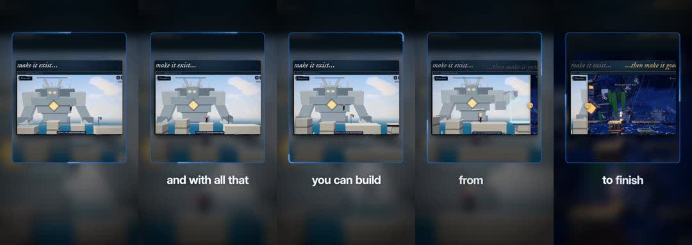

# v20_s14 · window_only · 28.8–31.0s (calidad 4)

- **Guion:** And with all that, you can build a full game from start to finish,
- **Qué se ve:** Lienzo azul oscuro: ventana con video comparativo 'make it exist… / …then make it good' (prototipo gris → versión final) que se desplaza lateralmente.
- **Diseño:** Rótulos serif itálica blanca dentro del video. 'game' azul.
- **Efectos:** Fondo blur azul #131921.
- **Animación:** [observed 28.87] corte; [observed 30.5–31.1] el video hace slide lateral mostrando la versión final.
- **Por qué aquí:** [inferred] 'start to finish' = prototipo→final.
