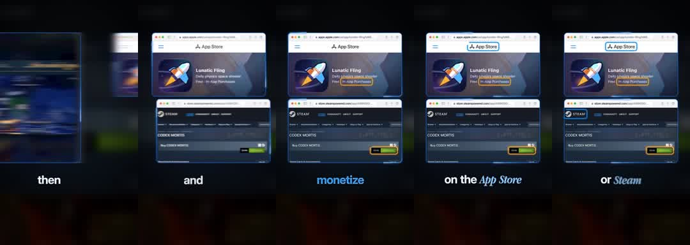

# v20_s15 · window_only · 31.1–33.5s (calidad 5)

- **Guion:** then publish, and even monetize it on the App Store or Steam.
- **Qué se ve:** Whip horizontal: entra ventana App Store (Lunatic Fling, 'In-App Purchases' recuadrado en naranja) y debajo ventana Steam (Codex Mortis) con el botón de compra recuadrado en amarillo; en 'App Store' se recuadra la etiqueta.
- **Diseño:** Dos ventanas apiladas x 10–90 %, y 13–39 % y 40–66 %. Contornos naranja/amarillo ~#F5A623. 'monetize' azul; 'App Store', 'Steam' serif itálica.
- **Efectos:** Fondo blur oscuro.
- **Animación:** [observed 31.2–31.53] whip horizontal (clip sale a la izq. con blur, App Store entra desde la der.); [observed 31.5–31.6] Steam entra debajo; [observed 32.0, 33.0] recuadros.
- **Por qué aquí:** [inferred] Literal: tiendas reales donde publicar y cobrar.
