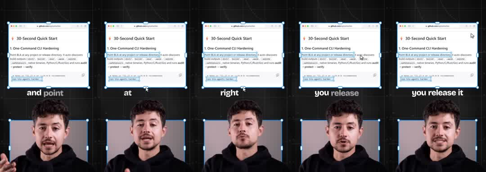

# v01_s06 · window_zoom · 10.5–12.4s (calidad 3)

- **Guion:** and point it at your app right before you release it.
- **Qué se ve:** [obs] Misma página; aparece un recuadro de resaltado azul sobre 'Point BLA at any project or release directory' y luego sobre el comando 'npx bla-agents harden .'; un cursor se mueve por la página.
- **Diseño:** [obs] Resaltado = rectángulo con borde azul fino y relleno azul muy claro sobre el texto (estilo selección).
- **Efectos:** [obs] Sin zoom de cámara; solo resaltado.
- **Animación:** [obs] Resaltado aparece en 'point' (~10.6) y en 'release' (~11.9) como marco que se dibuja; cursor visible 11.9–12.2.
- **Por qué aquí:** [inf] Literal: 'apúntalo a tu app' → se marca exactamente la instrucción y el comando.
