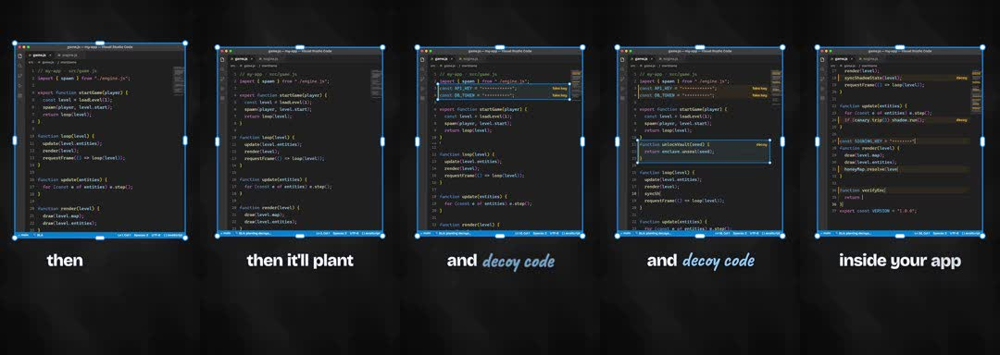

# v01_s07 · window_zoom · 12.5–15.8s (calidad 4)

- **Guion:** Then it'll plant fake keys and decoy code inside your app.
- **Qué se ve:** [obs] Sin cara: ventana alta de VS Code (game.js — my-app) ocupa arriba y centro; caption bajo la ventana. Se resaltan líneas en ámbar con etiquetas 'fake key'/'decoy' mientras dice 'fake keys' y 'decoy code'.
- **Diseño:** [obs] Ventana 82.6 % ancho × ~53 % alto (y 13.2–66 %). Caption y 71.7–74.9 %. 'decoy code' en serif itálica azul claro.
- **Efectos:** [obs] Líneas resaltadas con relleno ámbar translúcido y borde ámbar; etiqueta derecha 'decoy' / 'fake key'.
- **Animación:** [obs] Corte en 12.25: la cara desaparece y la ventana entra algo más grande (~105 %) y asienta en 2–3 frames (12.4→12.5). Scroll de código hacia abajo; resaltados aparecen fila a fila en 'fake' (~13.1) y 'decoy' (~14.1); 'inside your app' 15.3 resaltado de bloque.
- **Por qué aquí:** [inf] Explica el mecanismo: se quita la cara para dar toda la altura al código y que se lean los señuelos.
