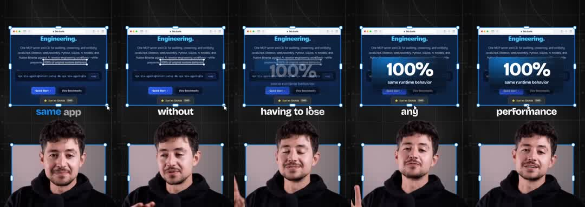

# v01_s11 · window_zoom · 23.9–25.8s (calidad 4)

- **Guion:** app without having to lose any performance at all.
- **Qué se ve:** [obs] Sobre la web aparece una tarjeta '100% same runtime behavior' grande centrada dentro de la ventana.
- **Diseño:** [obs] '100%' sans black blanca ~3.5 % alto, subtítulo pequeño; tarjeta oscura semitransparente con borde azul.
- **Efectos:** [inf] desenfoque/oscurecido del fondo de la web detrás de la tarjeta.
- **Animación:** [obs] Pop en 'any' (~25.0): aparece en 1–2 frames con leve escala.
- **Por qué aquí:** [inf] Dato que responde a la objeción de rendimiento: cifra grande = prueba.
