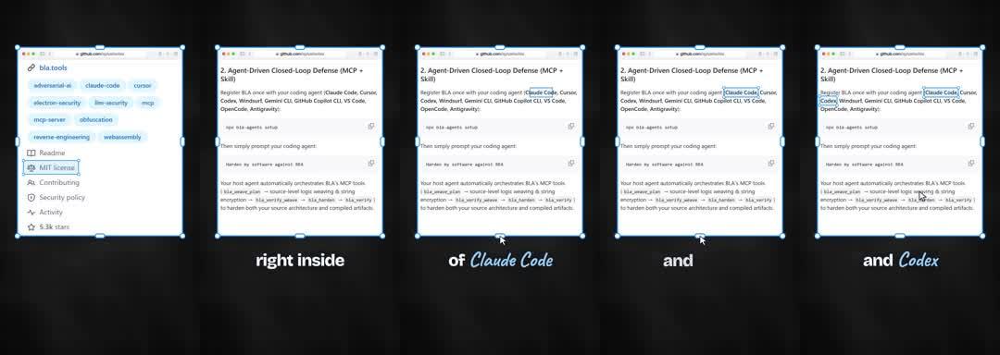

# v01_s13 · window_zoom · 27.3–28.9s (calidad 3)

- **Guion:** right inside of Cloudcode and Codex.
- **Qué se ve:** [obs] La ventana cambia a la sección '2. Agent-Driven Closed-Loop Defense (MCP + Skill)' y se resaltan 'Claude Code' y 'Codex' en el texto.
- **Diseño:** [obs] Caption 'of Claude Code' y 'and Codex' con el nombre en serif itálica azul.
- **Efectos:** [obs] Ninguno.
- **Animación:** [obs] Cambio de contenido en ~27.3 (scroll/corte interno); resaltado marco azul en 'Claude Code' ~28.0; cursor sobre el texto.
- **Por qué aquí:** [inf] Literal: nombra las herramientas → se marcan en la documentación (compatibilidad).
