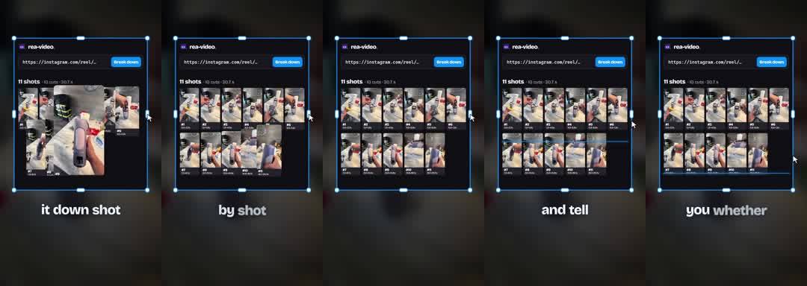

# v03_s06 · window_zoom · 12.4–13.6s (calidad 5)

- **Guion:** shot by shot, and tell you
- **Qué se ve:** [obs] El reel se fragmenta: sus planos salen como tarjetas que se reparten y forman la rejilla '11 shots · 10 cuts · 20.7 s'.
- **Diseño:** [obs] Rejilla 6 + 5 miniaturas con número y tiempo.
- **Efectos:** [obs] Tarjetas con leve sombra al volar.
- **Animación:** [obs] 12.1–12.6: un plano grande se escala sobre la rejilla y las tarjetas se despliegan (explosión) hasta asentarse; ~0.5 s, sensación rápida.
- **Por qué aquí:** [inf] 'break it down' visualizado como despiece literal del vídeo.
