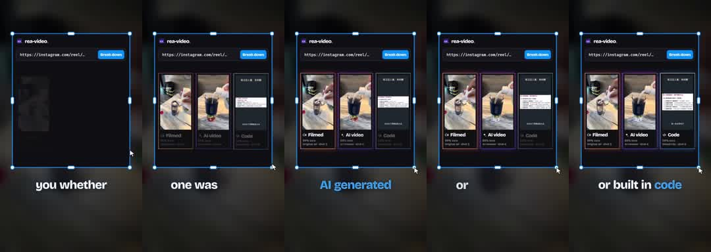

# v03_s07 · window_zoom · 13.6–16.0s (calidad 4)

- **Guion:** whether each one was filmed, AI generated, or built in code.
- **Qué se ve:** [obs] La ventana muestra 3 tarjetas de plano con etiqueta 'Filmed', 'AI video' y 'Code'; cada una se ilumina con su palabra.
- **Diseño:** [obs] Tarjetas con borde fino de color al activarse; 'filmed', 'AI generated', 'code' en azul en el caption.
- **Efectos:** [obs] Tarjetas no activas atenuadas.
- **Animación:** [obs] 13.75 se reordena a 3 tarjetas; 'Filmed' activa ~14.25, 'AI video' ~14.75, 'Code' ~15.5 (gris→blanco).
- **Por qué aquí:** [inf] Clasificación dicha = tarjeta que se enciende.
