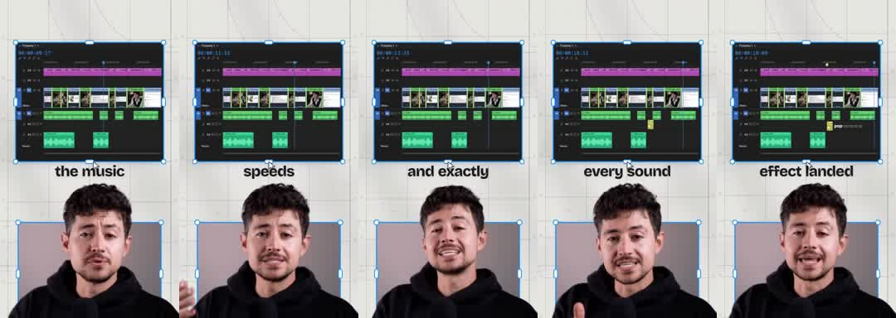

# v03_s09 · window_zoom · 18.7–21.6s (calidad 3)

- **Guion:** the music's beats, and exactly where every sound effect landed.
- **Qué se ve:** [obs] En la misma timeline se iluminan las pistas de audio verdes (onda de la música y bloques de SFX).
- **Diseño:** [obs] Clips verdes con forma de onda resaltados.
- **Efectos:** [obs] Ninguno.
- **Animación:** [obs] Pista de música se ilumina en 'music's' (~18.8–19.0); bloques de SFX en 'sound effect' (~20.7–21.0).
- **Por qué aquí:** [inf] Literal: cada tipo de dato extraído se señala en su pista.
