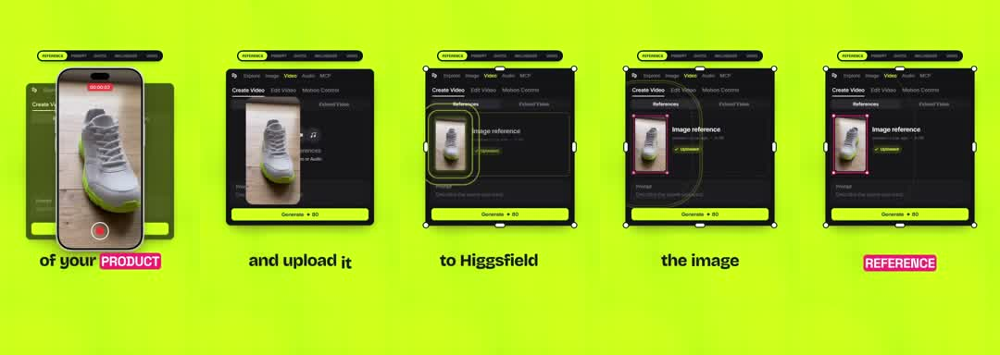

# v04_s04 · window_zoom · 5.1–6.9s (calidad 5)

- **Guion:** and upload it to HiggsField as the image reference.
- **Qué se ve:** [obs] El móvil se encoge y cae dentro de una ventana oscura de la app (Higgsfield 'Create Video'), ocupando la casilla 'Image reference'; un marco magenta con asas rodea la referencia. 'REFERENCE' en caja magenta.
- **Diseño:** [obs] Ventana oscura x≈9–91 %, y≈18–52 %, marco negro con asas cuadradas blancas; resaltado magenta #E22F6C con asas.
- **Efectos:** [obs] Ninguno.
- **Animación:** [obs] Match-cut: 5.15 la ventana aparece detrás del móvil (fade), 5.3–5.6 el móvil se reduce y se coloca en la casilla de referencia (~0.4 s); marco magenta dibujado 6.2–6.4.
- **Por qué aquí:** [inf] 'súbelo' visualizado como el vídeo entrando físicamente en la app (continuidad del objeto).
